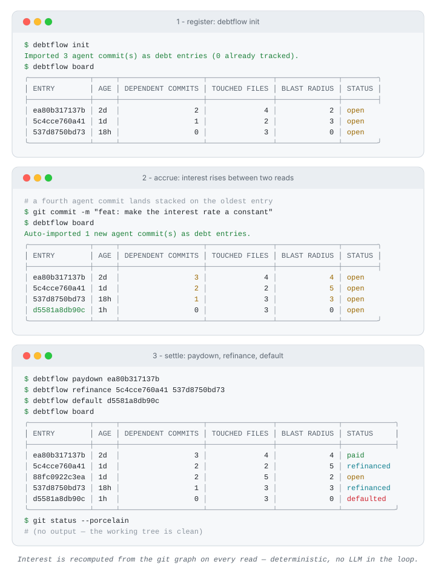

[English](./README.en.md) | **简体中文**

<div align="center">

# Debtflow

**把 AI 编码代理未评审的改动，记成一本带息债务账本。**

[](go.mod)
[](https://github.com/SuperMarioYL/debtflow/releases)
[](https://github.com/SuperMarioYL/debtflow/actions/workflows/ci.yml)
[](https://github.com/SuperMarioYL/debtflow/releases)
[](./LICENSE)


Coding Agent 一天写下的代码早已超过你能评审的量：每一笔没人看过的 agent 改动都在悄悄产生利息——依赖它的提交越堆越多，影响面越滚越大。Debtflow 把这些未评审改动记成一本带息债务账本，用 paydown、refinance、default 三个动作决定每一笔债是偿还、合并重审还是回滚清零。

单二进制 · 无守护进程 · 无网络依赖 · 计息过程没有任何 LLM

[演示](#-演示) · [快速开始](#-快速开始) · [命令](#-命令) · [付费](#-付费) · [路线图](#-路线图)

</div>

## &nbsp;演示

下图是 `debtflow board` 在一个种子仓库上的真实输出（完整命令与输出记录在 [docs/demo-results.json](docs/demo-results.json)）。三个面板分别是：登记、计息、清账。

<p align="center">
  
</p>

面板二就是这门生意本身：两次 `board` 读取之间，什么命令都没跑，最旧那笔债的 dependent commits 从 2 涨到 3、blast radius 从 2 涨到 4——只要没人评审，利息自己会长。

## &nbsp;为什么是「带息债务」

未评审的 agent 改动不是静止的。它在仓库里躺着的每一天，别的提交继续往上叠：依赖它的代码越写越多，它改过的文件被一再触碰，等你想看的时候，评审已经不只是原来那个 diff 了。

问题是现有工具都把它当静止列表：PR 队列里，一条两周前被十个提交叠着的 diff，和一条昨天刚落的 diff 长得一模一样。你看不到哪笔债在滚大。

Debtflow 换了一个记账模型——**每个未评审的 agent 提交是一笔带息债务**：

| 动作 | 语义 |
|---|---|
| `debtflow init` | 扫描仓库里未入账的 agent 提交，逐笔记债（每笔附一个指向改动前状态的 savepoint ref） |
| `debtflow board` | 打印账本：每笔债的账龄和三列利息，最旧的排最前 |
| `debtflow paydown <id>` | 评审通过，这笔债还清——利息冻结在当前读数 |
| `debtflow refinance <id1> <id2>` | 两笔小债并成一次评审——旧债标记 refinanced，新开一笔覆盖两者合并范围的账 |
| `debtflow default <id>` | 违约处理：从 savepoint 恢复改动前的树并提交，这笔债连同叠在它上面的东西一起清零 |

「利息」不是修辞，是三个可以机器验证的数字，每次读取都从 git 图重算：

| 利息列 | 含义 |
|---|---|
| DEPENDENT COMMITS | 沿 first-parent 线叠在该改动之上、直到 HEAD 的提交数（以 merge-base 锚定，侧分支合并进来的提交不计入） |
| TOUCHED FILES | 该改动自身 diff 涉及的文件数 |
| BLAST RADIUS | 那些叠加提交触及的、在这笔改动文件集之外的文件数 |

刻意没有 LLM 在环里：利息必须可机器验证，账本才可信。git 是唯一事实源，账本只是可以随时从历史重建的派生状态。

## &nbsp;安装

需要 Go 1.24+（或直接下载 [Release 二进制](https://github.com/SuperMarioYL/debtflow/releases)，覆盖 macOS / Linux / Windows × amd64 / arm64）：

```bash
go install github.com/SuperMarioYL/debtflow@latest
```

## &nbsp;快速开始

不想拿真实仓库试？用自带的种子脚本造一个有三笔 agent 提交的仓库（[examples/seed-demo-repo.sh](examples/seed-demo-repo.sh)）：

```bash
bash <(curl -fsSL https://raw.githubusercontent.com/SuperMarioYL/debtflow/main/examples/seed-demo-repo.sh)
cd debtflow-demo-repo

# 1. 记债：扫描 agent 提交，逐笔登记 + 建 savepoint ref
debtflow init

# 2. 看账本：三笔 open 的债，最旧的排最前
debtflow board
```

再造一笔 agent 提交叠上来，再读一次账——利息会涨，新提交自动入账：

```bash
cat > service/interest.go <<'EOF'
package service

// Rate is the per-item interest rate of the toy ledger.
const Rate = 1
EOF
git add -A
GIT_AUTHOR_NAME="Claude" GIT_AUTHOR_EMAIL="claude@anthropic.com" \
GIT_COMMITTER_NAME="Claude" GIT_COMMITTER_EMAIL="claude@anthropic.com" \
  git commit -q -m "feat: make the interest rate a constant"

debtflow board   # 最旧那笔的利息涨了；Auto-imported 1 new agent commit(s)
```

最后清账：

```bash
debtflow paydown <id>            # 评审完，还掉
debtflow refinance <id1> <id2>   # 两笔并成一次评审
debtflow default <id>            # 回滚到 savepoint，清零
```

在自己的仓库里用：`cd your-repo && debtflow init && debtflow board`。任何 git 托管平台（GitHub、Gitee、自建 GitLab……）上的仓库都可以——debtflow 只跟本地 git 历史打交道。

## &nbsp;命令

| 命令 | 作用 |
|---|---|
| `debtflow init` | 扫描未入账的 agent 提交，逐笔登记为账本条目并记录 savepoint ref |
| `debtflow board` | 打印账本表格（账龄 + 三列利息 + 状态），自动导入新 agent 提交，并重算所有 open 条目的利息 |
| `debtflow paydown <id>` | 标记某笔已评审的债为 paid，利息冻结 |
| `debtflow refinance <id1> <id2>` | 把两笔 open 的债并成一笔，覆盖两者合并范围 |
| `debtflow default <id>` | 恢复 savepoint 树并提交，条目标记 defaulted |

Agent 识别按作者名 / 邮箱 / Co-Authored-By 尾注做大小写不敏感的子串匹配，默认 `claude, codex, cursor`。如果团队里有人类名字会误伤（比如 Claudine），收窄匹配：

```bash
debtflow init --agents claude,codex,cursor-agent
```

两条已知边界，用之前该知道：

- `default` 恢复的是**整棵 savepoint 树**，不是区间回滚——叠在违约条目之上的提交会一并被丢弃。这是特性（止血），但也意味着对最旧的那笔债执行 default 前先想想。
- 账本存在本地 `.debtflow/ledger.jsonl`（自动写入 .gitignore），v0.1 没有同步与共享视图——那是 v0.2 团队账本服务要解决的事。

## &nbsp;工作原理

一个二进制，三个内部包，一个外部依赖：git 本身。

```
debtflow（单二进制）
├── gitrepo     — 调本地 git：first-parent 遍历、agent 提交识别、
│                 savepoint 记录与恢复、merge-base 锚定
├── ledger      — 追加式 JSONL 账本 + 纯函数计息（确定性，可重放）
└── cli/render  — cobra 命令 + lipgloss 账本表格渲染
```

- **savepoint**：每笔债登记时打一个 ref（`refs/debtflow/<id>`），指向改动前的那棵树。`default` 恢复的就是它，而不是做区间 revert——区间回滚会漏掉区间起点。
- **追加式账本**：`.debtflow/ledger.jsonl` 每行一笔。条目不删除、不重排，状态变化以事件形式追加在条目历史里（imported / accrued / paid / refinanced / defaulted），利息字段只是这些事件的最新读数。写文件走临时文件 + rename，崩溃不会撕坏行；读取若无变化则不落盘。
- **每次读取都是一次计息**：`board` 和三个动词都先重算 open 条目的利息再干活，没有单独的 "accrue" 命令要记得跑。

## &nbsp;常见问题

**这和评审收件箱类工具（比如 Pinrail）是一回事吗？**
不是。收件箱把待评审条目平铺排队，条目不会变化；Debtflow 记账——利息随时间涨，paydown / refinance / default 是账本动作，不是收件箱勾选。两者可以搭配用：收件箱管「现在看什么」，账本管「拖着不看在付出什么」。

**为什么不用 LLM 判断风险？**
刻意不做。LLM 的判断不可复现，账本的数字必须可机器验证——这三列利息就是 git 图上的确定性数学，任何人重跑都得到同一个数。想判断代码质量，拿任何评审工具和 Debtflow 搭配。

**这不就是个 git log 脚本吗？**
可以自己写，计息逻辑本来就是确定的。Debtflow 交付的是省掉的手工活：savepoint refs、追加式账本、三个结算动词，以及在每一次读取时自动把新 agent 提交入账。

## &nbsp;付费

单机 CLI 开源免费，账本存在你自己的仓库里。团队的问题是账本不在同一页上——谁欠的债最多、整个团队的评审负债这周涨了多少，单机文件回答不了。

v0.2 规划中的**团队账本服务**把本地账本升级成团队共享视图：

| | 单机 CLI（v0.1，已发布） | 团队账本服务（v0.2，规划中） |
|---|---|---|
| 形态 | 开源单二进制 | 托管服务（自托管版开源免费） |
| 账本 | 本地 `.debtflow/ledger.jsonl` | 团队共享账本 |
| 债务指派、merge-gate hook | — | 包含 |
| 价格 | 免费 | ¥79/座/月（≤5 座免费）、¥790/座/年；国际版 $15/座/月 |

路径是先让单机 CLI 在团队里跑起来，再开放 14 天托管试点；试点不愿付费，就砍掉服务端——这条决定规则写在路线图里。想上试点或对定价有想法，来 [Discussions](https://github.com/SuperMarioYL/debtflow/discussions) 说一声。

## &nbsp;路线图

- [x] **v0.1（当前）** — `init` / `board` / `paydown` / `refinance` / `default`；savepoint refs；每次读取从 git 图重算利息；追加式 JSONL 账本
- [ ] **v0.2** — 团队账本服务：共享账本、债务指派、merge-gate hook；托管付费层（见 [付费](#-付费)）

<p align="center"><sub><a href="./LICENSE">MIT</a> © 2026 SuperMarioYL</sub></p>
